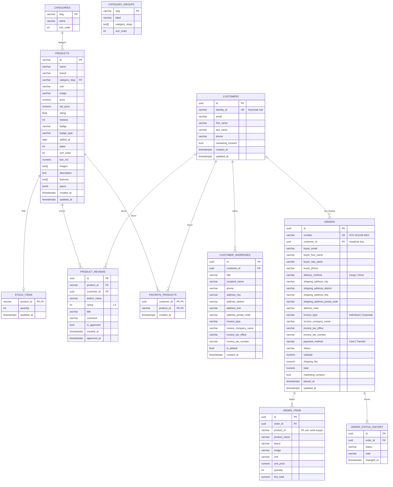

# Veritabanı Şeması

PostgreSQL 17. Her modül kendi şemasında durur; tablo ve kolon adları `snake_case`.
Şema EF Core migration'larıyla yönetilir (`src/Soykok.Infrastructure/Persistence/Migrations`).

| Şema        | Tablolar | Açıklama |
|-------------|----------|----------|
| `catalog`   | `categories`, `category_groups`, `products` | Ürün kataloğu |
| `customers` | `customers`, `customer_addresses`, `favorite_products` | Üye profili (kimlik Keycloak'ta), kayıtlı adresler, favoriler |
| `ordering`  | `orders`, `order_items`, `order_status_history` | Siparişler |
| `inventory` | `stock_items` | Ürün stokları |
| `reviews`   | `product_reviews` | Ürün yorumları |
| `public`    | `__ef_migrations_history` | Uygulanan migration'lar |

## İlişki diyagramı



## Tasarım kararları

- **Kimlik Keycloak'ta.** `customers` tablosunda şifre yoktur; `identity_id` Keycloak token'ındaki `sub`
  değeridir (benzersiz).
- **Sipariş anlık kopya tutar.** Alıcı, adres, fatura ve ürün bilgileri (`order_items.product_name`,
  `unit_price` ...) sipariş anındaki haliyle saklanır. Ürün fiyatı değişse ya da ürün silinse de geçmiş
  siparişler bozulmaz; bu yüzden `order_items.product_id` üzerinde FK yoktur.
- **Misafir siparişi.** `orders.customer_id` boş olabilir. Misafir sipariş takibi numara + e-posta ile
  yapılır (`buyer_email` index'li). Üye silinirse siparişleri silinmez, `customer_id` boşalır.
- **Durum geçmişi.** Her durum değişikliği `order_status_history`'ye yazılır (takip ekranındaki adımlar).
  İzin verilen geçişler `Order` varlığındadır:
  `AwaitingPayment → Received → Preparing → Shipped → Delivered`, teslimattan önce `Cancelled`.
- **Para** `numeric(12,2)`; **tarihler** `timestamptz` (UTC); **kimlikler** `uuid` v7 (zamana göre sıralı,
  index'te dağılmaz). Ürün ve kategori kodları frontend ile uyumlu olsun diye metin (`p1`, `laminat`).
- **Enum'lar metin** olarak saklanır (`'Received'`), sorgularda okunabilir olsun diye.
- **Veri bütünlüğü** check constraint'lerle de korunur: `total = subtotal + shipping_fee`,
  `line_total = unit_price * quantity`, `quantity` 1–999, `stock_items.quantity >= 0`, `rating` 1–5.
- **Yorumlar** varsayılan olarak onaysızdır (`is_approved = false`); bir müşteri bir ürüne tek yorum yazabilir.
  `products.rating` ve `products.reviews` onaylı yorumlardan hesaplanan özet değerlerdir.

## Migration iş akışı

```bash
# 1) Domain'de varlığı / EF yapılandırmasını değiştir
# 2) Migration oluştur (bilgisayarda .NET gerekmez, Docker içinde çalışır)
./backend/scripts/add-migration.sh AddSomething
# 3) Oluşan dosyayı gözden geçir: backend/src/Soykok.Infrastructure/Persistence/Migrations/
# 4) Uygula
docker compose up -d --build migrator api
```

`migrator` servisi bekleyen migration'ları uygular, veritabanı boşsa örnek kataloğu ve stoğu yükler,
sonra kapanır. `api` servisi yalnızca migrator başarıyla biterse başlar. Migrator logları:
`docker compose logs migrator`.
